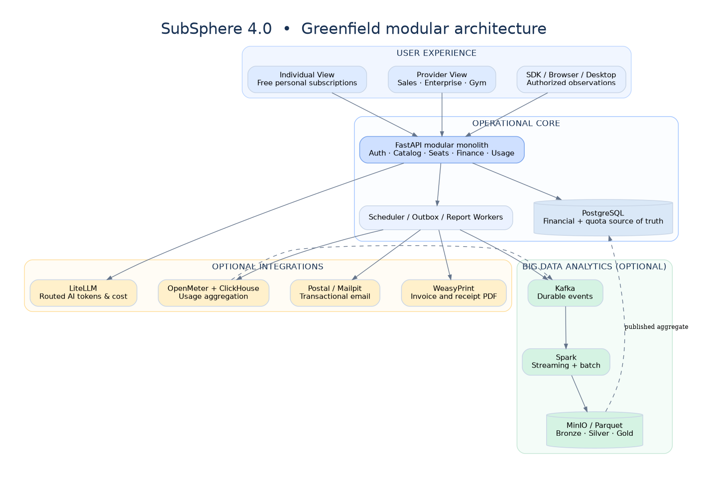
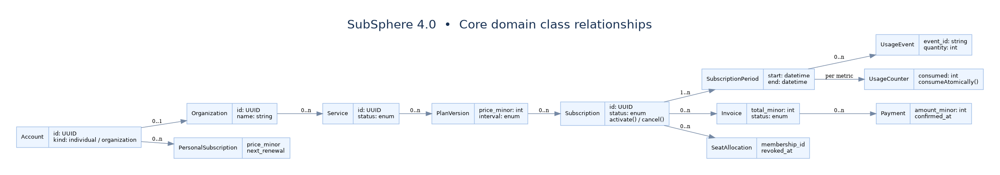

# SubSphere (v4.1)

**Know what is due, what was used, what is owed, what was collected, and what you actually spent—in one trustworthy place.**

SubSphere is a self-hostable, API-first **subscription, usage metering, AI telemetry, and financial intelligence platform** built around a clean **two-view architecture**:

- **Individual View (Free):** Track personal SaaS, AI, software, and gaming subscriptions, renewal calendars, masked-email reminders, and source-qualified AI usage across coding agents, gateways, MCP clients, and web tools.
- **Provider View (Business):** Manage organizations, services, immutable plan versions, CRM subscriber contacts (no forced signup), enterprise seat pools, receivables/payables, confirmed payment ledgers, atomic API usage quotas, PDF receipts/statements, and Big Data analytics.

---

## Key Highlights

### 1. Two-View Product Design (Zero Dashboard Sprawl)

| Individual — Free (7 Tabs) | Provider — Business (9 Tabs) |
| --- | --- |
| **Dashboard:** Currency-segregated monthly/annual spend, upcoming renewals, AI telemetry & credit overview | **Dashboard:** Collected cash, receivables, payables, overdue aging, recorded cash surplus & freshness status |
| **Subscriptions:** Full CRUD with optimistic locking (`version`), anchored calendar-month billing, one-time exclusion | **Subscribers & Employees:** Contact CRM without forced login, claim-invitation links, enterprise seat pools & identity mappings |
| **AI Usage Intelligence:** Universal Usage Connector across 5 measurements & 6 tracking methods + SubSphere MCP Server | **Services & Plans:** Sellable services, immutable published plan versions, generic metrics (`hard_limit` & `monitor_only`) |
| **Calendar:** 7-column timezone-aware month projection & agenda list view | **AI Usage:** Organization-scoped OTel/LiteLLM/MCP usage and employee attribution (never private browsing history) |
| **Reports:** Styled HTML + inline SVG chart previews, PDF statements, CSV/JSON exports & email dispatch | **Finance:** Receivables, payables, manual confirmed payments, expenses, signed adjustments & overdue checks |
| **Notifications:** SMTP preferences, renewal rules (`7/3/1` days), masked-email relay & inbox | **Documents & Notifications:** Branded PDF receipts/invoices, single-use expiring share links, SMTP & opt-in WhatsApp |
| **Settings & Privacy:** History deletion, data export, revocation & source isolation | **Calendar & Settings:** Billing calendar, scoped API keys, verified sender domains, webhooks & RBAC |

### 2. Universal Usage Connector & AI Usage Intelligence

Different AI tools expose different telemetry. Instead of guessing or fabricating token numbers, SubSphere normalizes telemetry across **five distinct measurements** and **six ranked tracking methods**, automatically selecting the most accurate method per app and plan tier:

| Measurement | What SubSphere Tracks | Provenance Rule |
| --- | --- | --- |
| **Model Requests** | Verified API/OTel/Gateway/MCP calls (kept separate from prompts & tool calls) | `reported` vs `unavailable` |
| **Tokens Consumed** | Input, output, cache read/creation, and total tokens | Exact when reported; `null` (`Unavailable`) when absent — never coerced to `0` |
| **Images** | Images generated (instrumented tools/APIs) & uploaded/examined | `reported` or `observed_interactions` |
| **Documents Accessed** | Source-code file reads, PDF/document reads, and generated documents | Metadata-only via agent tool hooks (never uploads file contents) |
| **Application Activity** | Focused active minutes & visits on allowlisted web/desktop apps | Explicitly labeled `observed_interactions` (`tokens: Unavailable`) |

**Six Practical Tracking Methods (Ranked by Accuracy):**
1. **Official Provider APIs** — Cursor Team/Business Admin API, OpenAI/Anthropic organization usage APIs.
2. **OpenTelemetry (OTel)** — Claude Code, Codex, and Cursor Enterprise OTLP export (`POST /v1/metrics`, downloadable `claude_code_connect.sh`, cumulative/delta checkpointing).
3. **Local AI Gateway (LiteLLM)** — Exact tokens, virtual keys, and billing-lane separation (`api_key` vs `claude_subscription`) for explicitly routed requests, with `request_ref` deduplication against OTel.
4. **Coding-Agent Hooks & SubSphere MCP Server** — Built-in JSON-RPC 2.0 MCP server (`GET/POST /api/v1/mcp` + zero-dependency `services/mcp-server/subsphere_mcp_server.py`) supporting HuggingChat (`huggingface.co/chat`), Claude Desktop, Cursor, and Claude Code.
5. **Browser Extension (Chrome MV3)** — Opt-in allowlisted domain observer (`services/browser-extension`) with focus/idle guards, retry queue, and opt-in history import; strips paths, queries, prompts, and cookies.
6. **Desktop Companion (`psutil`)** — Opt-in allowlisted foreground process time observer (`services/desktop-helper/helper.py`).

### 3. Strict Financial & Data Integrity Invariants

- **PostgreSQL as Authoritative Operational Plane:** Identities, RBAC, obligations, invoices, confirmed payments, seat caps, and atomic `hard_limit` quota counters (`POST /api/v1/usage/consume`) are enforced in serializable SQL transactions.
- **Exact Money Math:** All monetary values are stored in integer minor units (`BIGINT`) with `Decimal` (`ROUND_HALF_UP`) valuation against effective-dated `pricing_versions`. Multi-currency totals are never blindly summed.
- **Non-Additive AI Cost Separation:** Fixed `subscription_fee_minor`, metered `reported_extra_usage_minor`, and `estimated_token_value_minor` are always displayed separately.
- **Honest Accounting Semantics:** Invoices are claims (not proof of payment); receipts generate only for confirmed payments; `Recorded Cash Surplus` (`cash_collected - recorded_expenses`) is never mislabeled as audited net profit; SMTP relay acceptance (`accepted_by_relay`) is never falsely marked `delivered` without webhook proof.
- **Strict Privacy Guard:** Connector, OTel, extension, and desktop ingest endpoints reject raw prompts, document bodies, file contents, cookies, and passwords (`400`/`422`). Personal browser/desktop activity is never visible to employers.

---

## Architecture Overview





### Two-Plane Design

- **Operational Plane (`compose.yaml`):** FastAPI backend, React + TypeScript + Nginx frontend, PostgreSQL 16, transactional outbox/notification worker (`services/worker/outbox_dispatcher.py`), and sandboxed PDF report worker (`services/report-worker/worker.py`). Survives outages of Kafka, Spark, OpenMeter, LiteLLM, and SMTP relays.
- **Analytical & Integration Plane (Modular Compose Overlays):**
  - `compose.dev.yaml` — Mailpit dev SMTP capture (`:8025`)
  - `compose.ai.yaml` — LiteLLM AI gateway (`:4000`)
  - `compose.telemetry.yaml` — OpenTelemetry Collector (`:4317`, `--profile telemetry`)
  - `compose.metering.yaml` — OpenMeter + ClickHouse CloudEvents aggregation (`:8888`)
  - `compose.analytics.yaml` — Apache Kafka (KRaft) + PySpark Bronze/Silver/Gold Medallion pipeline + MinIO object storage (`:9092`, `:8081`, `:9000/:9001`)
  - `compose.observability.yaml` — Prometheus (`:9090`) + Grafana (`:3001`)
  - `compose.production.yaml` — Caddy HTTPS ingress & external Postal SMTP integration (`infra/postal/README.md`)

---

## Quick Start

### Prerequisites
- Docker Engine with Compose plugin (for full stack)
- Python 3.12+ & Node.js 22+ (for local tests and frontend development)

### Start the Complete Stack (One Command)

```bash
bash run-all.sh up
```

`run-all.sh` initializes `.env` (with safe local dev defaults), starts Core + Dev Mail + AI Gateway + Telemetry + Metering + Analytics + Observability containers, reloads Nginx, and runs database migrations (`python -m alembic upgrade head`).

| Service | Local URL |
| --- | --- |
| **Frontend Web App (React + Nginx)** | `http://127.0.0.1:8080` |
| **Backend API & Health Checks** | `http://127.0.0.1:8000` (`/health/live`, `/health/ready`) |
| **SubSphere MCP Endpoint** | `http://127.0.0.1:8080/api/v1/mcp` |
| **Universal Connector Catalog** | `http://127.0.0.1:8080/api/v1/connectors/catalog` |
| **Mailpit (Dev Email Inbox)** | `http://127.0.0.1:8025` |
| **OTel Collector (OTLP HTTP)** | `http://127.0.0.1:4317` |
| **LiteLLM Gateway** | `http://127.0.0.1:4000` |
| **OpenMeter API** | `http://127.0.0.1:8888` |
| **MinIO Console** | `http://127.0.0.1:9001` |
| **Spark Master UI** | `http://127.0.0.1:8081` |
| **Prometheus / Grafana** | `http://127.0.0.1:9090` / `http://127.0.0.1:3001` |

### Useful `Makefile` & CLI Commands

```bash
./run-all.sh config        # Validate all Compose files
./run-all.sh ps            # Check container health
./run-all.sh logs          # Stream logs
./run-all.sh down          # Stop stack (preserves named volumes)

make up-core               # Start only core operational plane
make test                  # Run full backend pytest suite
make test-calendar         # Run calendar projection tests
make test-email            # Run SMTP & reminder tests
make test-otel             # Run OTel & LiteLLM gateway tests
make smoke                 # Validate Compose + backend pytest + frontend production build
```

---

## Developer SDKs & Integrations

### Python SDK (`sdk/python/subsphere_sdk/client.py`)
```python
from subsphere_sdk.client import SubSphereClient

client = SubSphereClient(api_key="sk_svc_...", base_url="http://127.0.0.1:8000")
result = client.consume_usage(
    subscription_id="sub_123",
    metric_key="api_requests",
    quantity=1,
    external_event_id="evt_unique_001",
)
```

### TypeScript SDK (`sdk/typescript/src/index.ts`)
```ts
import { SubSphereClient } from "./sdk/typescript/src";

const client = new SubSphereClient("sk_svc_...", "http://127.0.0.1:8000");
const res = await client.consumeUsage({
  subscriptionId: "sub_123",
  metricKey: "api_requests",
  quantity: 1,
});
```

### SubSphere MCP Server (`services/mcp-server/subsphere_mcp_server.py`)
- **HTTP MCP (HuggingChat / Web MCP Clients):** Generate an MCP token in **AI Usage Intelligence → SubSphere MCP Server Setup** and paste `http://127.0.0.1:8080/api/v1/mcp?token=<TOKEN>` into your client.
- **Stdio MCP (Claude Desktop / Cursor / Claude Code):** Download `subsphere_mcp_server.py` from `/api/v1/mcp/install.py` (Python 3 stdlib only, zero external dependencies).
- Exposed MCP tools: `subsphere_report_usage`, `subsphere_get_usage_summary`, `subsphere_list_subscriptions`, `subsphere_add_subscription`, and `subsphere_record_connector_event`.

### Chrome MV3 Extension (`services/browser-extension`)
Load unpacked via `chrome://extensions` (Developer Mode → **Load unpacked** → select `services/browser-extension`). Observes only allowlisted domains (`chatgpt.com`, `claude.ai`, `huggingface.co`), active focus duration, and visit counts—never URLs, prompts, DOM text, or cookies.

---

## Core API Families (`/api/v1`)

| Family | Representative Endpoints |
| --- | --- |
| **Auth & Tenancy** | `POST /auth/register`, `/auth/login`, `/auth/verify-email`, `/auth/reset-password`, `GET /me`, `POST /organizations` |
| **Individual & Calendar** | `CRUD /personal/subscriptions`, `GET /personal/dashboard`, `GET /calendar/events`, `DELETE /personal/history`, `GET /personal/export` |
| **Universal Connector & AI** | `GET /connectors/catalog`, `POST /connectors/connect`, `POST /connectors/events`, `GET /connectors/intelligence`, `GET /ai/usage`, `POST /v1/metrics`, `GET/POST /mcp` |
| **Provider Catalog & CRM** | `POST /services`, `/services/{id}/plans`, `/plans/{id}/versions`, `/subscribers`, `/subscribers/{id}/invite`, `/invites/{token}/claim` |
| **Enterprise & Metering** | `POST /enterprise/subscriptions`, `/seat-allocations`, `/identity-mappings`, `POST /usage/consume`, `GET /entitlements/check` |
| **Finance & Reports** | `POST /finance/obligations`, `/invoices/{id}/payments`, `/finance/expenses`, `GET /finance/kpis`, `POST /reports`, `GET /reports/{id}/preview`, `/download`, `/share-link` |
| **Notifications & Analytics** | `PATCH /notifications/preferences`, `POST /notifications/test-email`, `GET /notifications/masked-inbox`, `POST /analytics/outbox/dispatch`, `POST /analytics/medallion/run`, `GET /analytics/reconciliation` |

---

## Testing & Benchmarks

### Automated Verification

```bash
# Backend unit + integration suite (39 tests across M0–M7, v4.1 matrix, MCP & Universal Connector)
cd backend && python3 -m pytest -v
# Observed: 39 passed, 0 failed, 0 skipped

# Frontend TypeScript check & Vite production bundle
npm --prefix frontend run build
# Observed: tsc --noEmit && vite build exited 0
```

### Data Platform & Concurrency Benchmarks (`data-platform/benchmarks/run_benchmarks.py`)

Measured on `Linux x86_64`, Python `3.12.3`, `4` logical CPUs, `15.49 GB` RAM (full JSON artifact in [`data-platform/benchmarks/latest_results.json`](data-platform/benchmarks/latest_results.json)):

| Benchmark | Workload | Observed Result | Invariant |
| --- | --- | --- | --- |
| **B-01** | 10,000 events Bronze → Silver → Gold | `131.05 ms` (`76,305.6 events/s`) | Zero discrepancy |
| **B-02** | 100,000 events Bronze → Silver → Gold | `1,207.48 ms` (`82,817.1 events/s`) | Zero discrepancy |
| **B-03** | 1,000,000 events Bronze → Silver → Gold | `10,992.29 ms` (`90,972.9 events/s`) | Zero discrepancy |
| **B-04** | 100,000 events with 10% duplicate storm | `1,307.19 ms` (`76,500.2 events/s`, `10,000` deduped) | Zero discrepancy |
| **B-05..08** | OpenMeter outage recovery & checkpoint replay | `45.28 ms` (`11` Kafka delivered, `11` recovered) | `0` replay duplicates |
| **B-09** | 20 concurrent quota requests (10 remaining) | `345.95 ms` (`p50=238.84 ms`, `p95=277.54 ms`) | `10` accepted, `10` rejected (`409`), `0` overshoot |
| **B-10** | 50 concurrent threads / 200 dashboard reads | `1,764.20 ms` (`p50=292.16 ms`, `p95=743.70 ms`) | `200/200` HTTP 200, `0` errors |

---

## Repository Structure

```text
SubSphere_Project/
├── backend/                  # FastAPI operational core, SQL schema, Alembic migrations, 39 pytest tests
│   ├── app/                  # auth, personal, organizations, catalog, subscribers, subscriptions,
│   │                         # finance, providers, metering, integrations, notifications, reports, analytics
│   └── tests/                # unit + integration test suites (M0–M7 + v4.1 + MCP + Universal Connector)
├── frontend/                 # React 19 + TypeScript + Vite SPA (IndividualView & ProviderView) + Nginx proxy
├── services/
│   ├── browser-extension/    # Chrome MV3 privacy-safe allowlisted domain observer
│   ├── desktop-helper/       # Opt-in psutil foreground activity observer
│   ├── mcp-server/           # Standalone Python 3 stdlib SubSphere MCP stdio/CLI server
│   ├── worker/               # Transactional outbox, reminder scheduler & SMTP/WhatsApp dispatcher
│   ├── report-worker/        # Sandboxed HTML/SVG/PDF snapshot report renderer
│   └── containers/           # Local dev container runners (LiteLLM, OpenMeter, MinIO, Spark, OTel)
├── data-platform/            # PySpark Bronze/Silver/Gold Medallion pipeline & B-01..B-10 benchmark suite
├── sdk/                      # Python & TypeScript metering SDKs
├── infra/                    # Modular Docker Compose overlays, Postal guide, Prometheus config, backup/restore CLI
├── docs/                     # Architecture specs, API contracts, wireframes, ADRs, Mermaid & PNG/SVG diagrams
├── SUBSPHERE_COMPLETE_SPEC.md
├── Makefile
└── run-all.sh
```

---

## Documentation & Diagrams

- [Complete Specification (`SUBSPHERE_COMPLETE_SPEC.md`)](SUBSPHERE_COMPLETE_SPEC.md)
- [Master Implementation Directive](docs/MASTER_IMPLEMENTATION_DIRECTIVE.md)
- [Class & Data Model](docs/CLASS_AND_DATA_MODEL.md) · [API Contracts](docs/API_CONTRACTS.md) · [Wireframes](docs/WIREFRAMES.md)
- [Architecture Decision Log (ADR-001 – ADR-011)](docs/DECISIONS.md)
- [Open-Source Integration Contracts](docs/OPEN_SOURCE_INTEGRATIONS.md) · [Deployment Guide](docs/DEPLOYMENT.md)
- [Test Plan](docs/TEST_PLAN.md) · [Test & Benchmark Results](docs/TEST_RESULTS.md) · [v4.1 Progress](docs/implementation-progress-v4.1.md)
- [Diagrams Index (Mermaid + PNG/SVG)](docs/diagrams/README.md)

---

## Production & Compliance Notice

SubSphere is an engineering and startup-foundation platform. Before deploying to production:
- Replace all local default secrets in `.env` and enable TLS (`infra/compose/compose.production.yaml`).
- Deploy Postal independently with verified SPF/DKIM/DMARC DNS records for outbound email, and use official WhatsApp Business Platform credentials with documented recipient opt-in.
- Review upstream licenses for pinned third-party components and validate jurisdiction-specific tax/accounting requirements.
